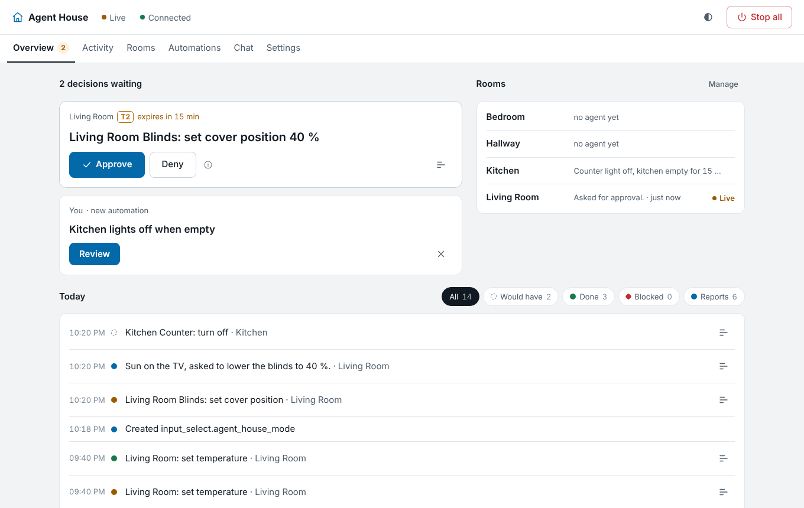
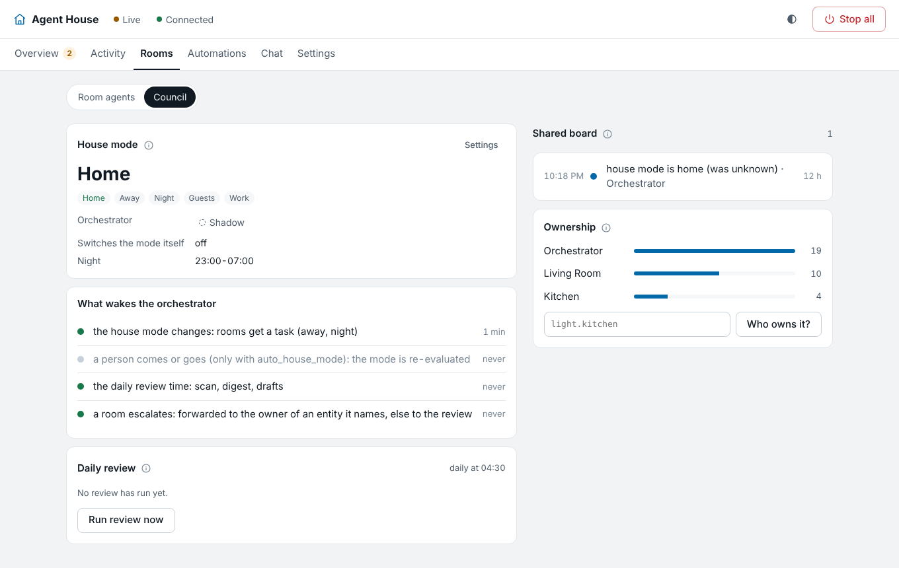
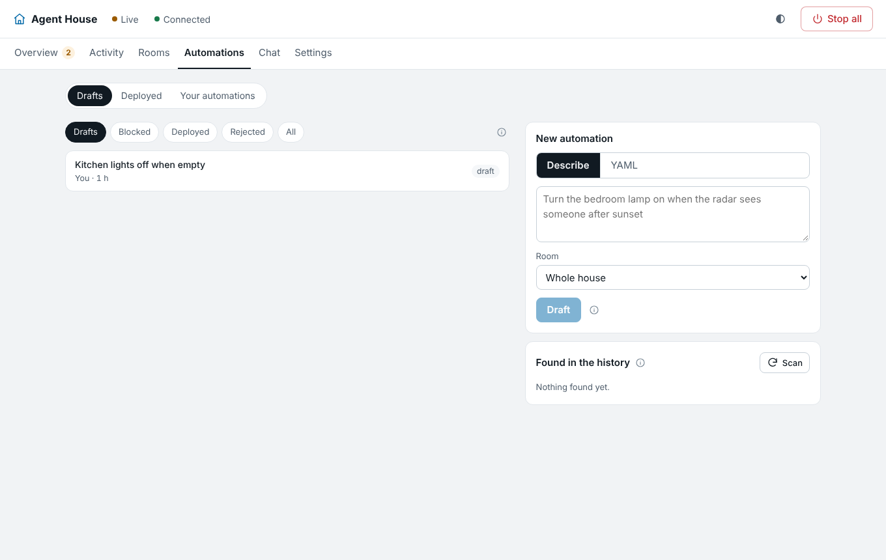

# Agent House

A Home Assistant add-on that learns how your house is used and writes the automations for you.

- A **learner** on a Jetson Orin Nano keeps months of the house's history and learns from it every
  night: habits, routines, what follows what, which automations you keep correcting. It holds no
  Home Assistant token and never acts on its own; its live suggestions go through the add-on's
  safety layer.
- An **orchestrator** (Claude or OpenAI) reads what the learner found, drafts automations for you to
  approve, explains and changes them in words, chats, and looks after the house between the daily
  reviews as the **house manager** (only when a cheap deterministic check finds something).
- **Reflexes stay deterministic**: approved automations live in Home Assistant itself and keep
  running when the add-on, the Jetson or the internet is down.



## Status: v0.5.0 (prototype)

Everything in the plan is built and tested against simulators; the owner's hardware runs are
tracked in [`docs/OWNER_CHECKLIST.md`](docs/OWNER_CHECKLIST.md). Progress: [`docs/PLAN.md`](docs/PLAN.md).
Operating it: [`docs/RUNBOOK.md`](docs/RUNBOOK.md). Since 0.5.0 there are no room agents and no local
model ([D40](docs/DECISIONS.md)).

- **Learner** (D38): the add-on forwards every change with its cause; the learner's habits replace
  the add-on's own 14-day scan while its model is fresh (the add-on's scan stays as the fallback).
- **Orchestrator**: drafts automations on Claude or OpenAI (redacted, daily budget with a hard stop),
  per request on the model you pick. Every draft is checked (YAML, schema, policy, Home Assistant's
  own validation), simulated against history, deployed only on your approval, versioned and
  reversible.
- **House manager**: a deterministic sweep (lights on with nobody home, automations you keep
  undoing, a light controller you keep correcting) wakes the model only when it finds something; it
  acts on devices through the safety policy, in shadow until you set it live.
- **History, not guesses**: habits are predictions checked on days they had not seen; automations you
  keep undoing and automations that fight become one proposal each in the daily review.
- **Migration** from your HA automations, scripts and Node-RED exports, with a parity report and a
  reversible "switch the original off". **Chat** with the orchestrator.

| Rooms → Council | Automations → Drafts |
|---|---|
|  |  |

Developed in the cloud without access to the target hardware. Everything is tested against
simulators and a real headless Home Assistant Core; what only the real Pi, Jetson and HA can
confirm is listed in [`docs/OWNER_CHECKLIST.md`](docs/OWNER_CHECKLIST.md).

## Install

Add `https://github.com/vvvlladimir/agent-home` as an add-on repository in Home Assistant, install
**Agent House**, start it and open it from the sidebar. Details and options:
[`agent_house/DOCS.md`](agent_house/DOCS.md).

## Develop

```bash
make install
```

```bash
make ci
```

```bash
make sim
```

`make sim` starts the app inside a simulated home: a fake Home Assistant with a realistic, messy
house (Zigbee2MQTT, router trackers, junk entities, 14 days of history), fake Claude and OpenAI, and
the real learner in-process. Open the add-on at `http://127.0.0.1:8100/`. The **sim panel** at
`http://127.0.0.1:8090/` controls the house size, the event flow, scenarios and faults, shows the
learner and trains it now. It also points the learner at a real Jetson by IP and the orchestrator at
the real OpenAI and Claude APIs ([RUNBOOK → Simulator](docs/RUNBOOK.md#simulator)).

| Path | What |
|---|---|
| `agent_house/` | the add-on: packaging + `app/` (FastAPI backend, static GUI) |
| `contracts/` | OpenAPI for the GUI API and JSON Schemas for every file format |
| `sim/` | simulators, so nothing needs hardware |
| `tests/` | unit, integration, and opt-in tests against real HA Core (`make test-realha`) |
| `jetson/` | what runs on the Jetson: the learner and its setup scripts |
| `owner-reports/` | results from the real hardware |
| `docs/` | plan, research, decisions, owner checklist, runbook |

## Safety model in one paragraph

Shadow Mode by default, globally and for each actor (the learner, the house manager); a global
kill switch; four permission tiers with deny-by-default (locks, alarm, valves and garage doors are
never actuated); the learner and the house manager reach Home Assistant only through one
policy-checked, logged actuation path; automations are drafts until the owner approves them and are
deployed with an `agent_house_` id; the owner's own automations are never edited or deleted; cloud
prompts are redacted.
