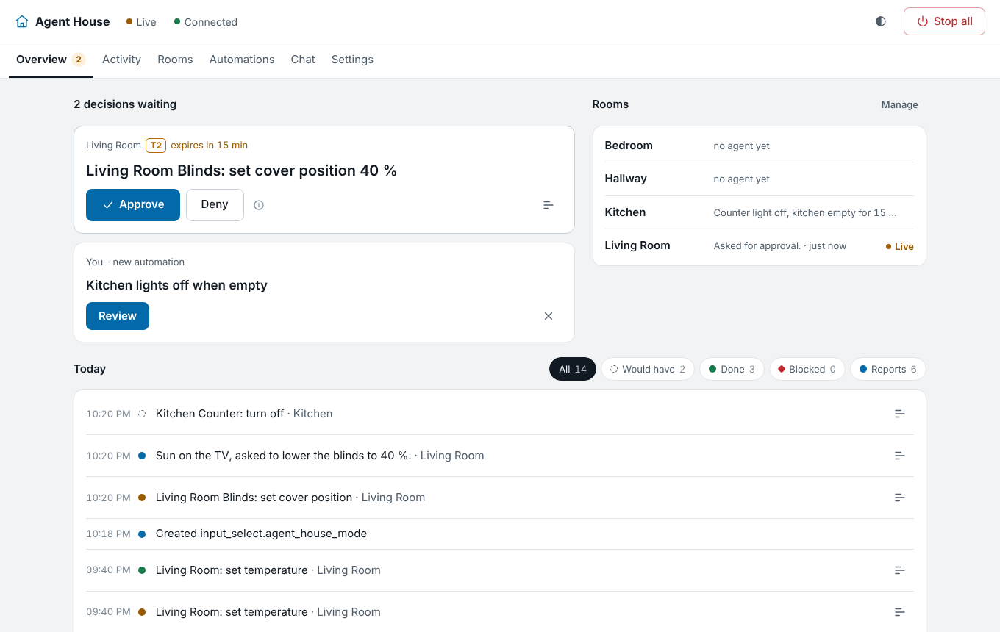
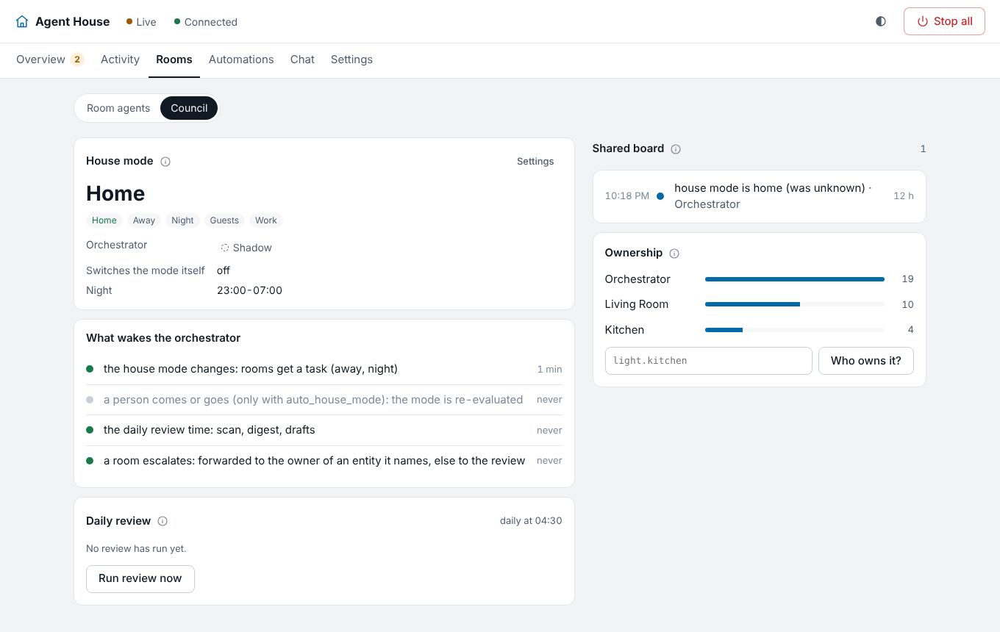
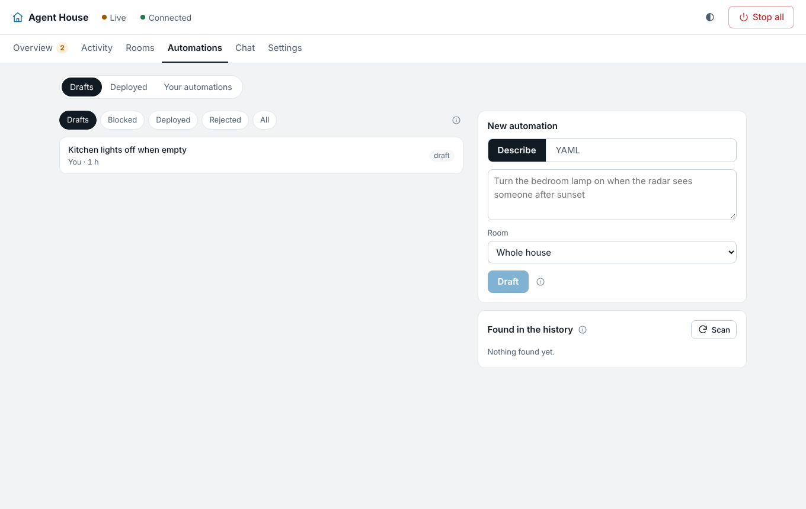

# Agent House

LLM agents that run a smart home, packaged as a Home Assistant add-on.

- **Room agents** (small local model on a Jetson Orin Nano) wake on filtered events, read their
  room and act through a strict tool API.
- An **orchestrator** (Claude or a local model) sees summaries of the whole house and writes
  automations for the owner to approve.
- **Reflexes stay deterministic**: approved automations live in Home Assistant itself and keep
  running when the add-on, the Jetson or the internet is down.



## Status: v0.1.0 (prototype)

Everything in the plan is built and tested against simulators; the owner's hardware runs are
tracked in [`docs/OWNER_CHECKLIST.md`](docs/OWNER_CHECKLIST.md). Progress: [`docs/PLAN.md`](docs/PLAN.md).
Operating it: [`docs/RUNBOOK.md`](docs/RUNBOOK.md).

- **Room agents** in Shadow Mode by default: wake rules, tiers, a single policy-checked actuation
  path, traces you can replay and turn into test cases.
- **Orchestrator**: drafts automations on the local model, with Claude or OpenAI as the expert for
  hard cases (redacted, daily budget with a hard stop). Every draft is checked (YAML, schema,
  policy, Home Assistant's own validation), simulated against history, deployed only on your
  approval, versioned and reversible.
- **Agent council**: every entity has exactly one owner agent; rooms share short facts on a board
  instead of chatting; a house mode helper (`input_select.agent_house_mode`) carries home / away /
  night / guests / work into Home Assistant; tasks go down from the orchestrator, escalations up.
- **History, not guesses**: a deterministic scan finds habits (a lamp you switch on by hand after a
  sensor), automations you keep undoing and automations that fight; the daily review turns them
  into one proposal each.
- **Migration** from your HA automations, scripts and Node-RED exports, with a parity report and a
  reversible "switch the original off". **Chat** with the orchestrator or a room.

| Rooms → Council | Automations → Drafts |
|---|---|
|  |  |

Developed in the cloud without access to the target hardware. Everything is tested against
simulators and a real headless Home Assistant Core; what only the real Pi, Jetson and HA can
confirm is listed in [`docs/OWNER_CHECKLIST.md`](docs/OWNER_CHECKLIST.md).

## Install

Add `https://github.com/vvvlladimir/agent-home` as an add-on repository in Home Assistant, install
**Agent House**, start it and open it from the sidebar. Details and options:
[`agent_house/DOCS.md`](agent_house/DOCS.md).

## Develop

```bash
make install
```

```bash
make ci
```

```bash
make sim
```

`make sim` starts the app inside a simulated home: a fake Home Assistant with a realistic, messy
house (Zigbee2MQTT, router trackers, junk entities, 14 days of history), and fake llama-server,
Claude, OpenAI and Jetson metrics. Open the add-on at `http://127.0.0.1:8100/`. The **sim panel** at
`http://127.0.0.1:8090/` controls the house size, the event flow, scenarios and faults. It also
switches the model ports to a real Jetson by IP or to the real OpenAI and Claude APIs
([RUNBOOK → Simulator](docs/RUNBOOK.md#simulator)).

| Path | What |
|---|---|
| `agent_house/` | the add-on: packaging + `app/` (FastAPI backend, static GUI) |
| `contracts/` | OpenAPI for the GUI API and JSON Schemas for every file format |
| `sim/` | simulators, so nothing needs hardware |
| `tests/` | unit, integration, and opt-in tests against real HA Core (`make test-realha`) |
| `jetson/` | scripts that run on the Jetson: setup, llama.cpp build, profiles, metrics, benchmarks |
| `owner-reports/` | results from the real hardware, read by `make analyze-report` |
| `docs/` | plan, research, decisions, owner checklist, runbook |

## Safety model in one paragraph

Shadow Mode by default; a global kill switch; four permission tiers with deny-by-default (locks,
alarm, valves and garage doors are never actuated); agents reach Home Assistant only through a
policy-checked, traced tool layer; agent-written automations are drafts until the owner approves
them and are deployed with an `agent_house_` id; the owner's own automations are never edited or
deleted.
