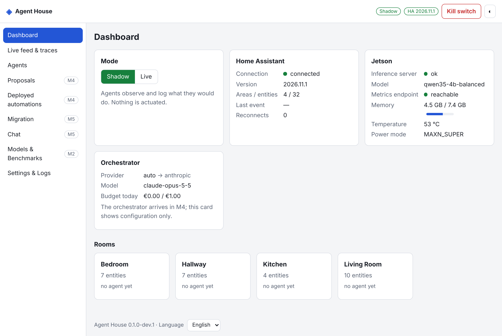

# Agent House

LLM agents that run a smart home, packaged as a Home Assistant add-on.

- **Room agents** (small local model on a Jetson Orin Nano) wake on filtered events, read their
  room and act through a strict tool API.
- An **orchestrator** (Claude or a local model) sees summaries of the whole house and writes
  automations for the owner to approve.
- **Reflexes stay deterministic**: approved automations live in Home Assistant itself and keep
  running when the add-on, the Jetson or the internet is down.



## Status: M1 skeleton

The add-on installs, opens through Ingress and connects to Home Assistant **read-only**: status,
rooms, entities with their permission tier, a live feed, logs and a diagnostics bundle. No agent
runs yet and nothing is actuated. Progress: [`docs/PLAN.md`](docs/PLAN.md).

Developed in the cloud without access to the target hardware. Everything is tested against
simulators and a real headless Home Assistant Core; what only the real Pi, Jetson and HA can
confirm is listed in [`docs/OWNER_CHECKLIST.md`](docs/OWNER_CHECKLIST.md).

## Install

Add `https://github.com/vvvlladimir/agent-home` as an add-on repository in Home Assistant, install
**Agent House**, start it and open it from the sidebar. Details and options:
[`agent_house/DOCS.md`](agent_house/DOCS.md).

## Develop

```bash
make install
```

```bash
make ci
```

```bash
make sim
```

`make sim` starts a fake Home Assistant, fake llama-server, fake Anthropic API and fake Jetson
metrics, then the app behind a fake ingress proxy, and prints the URL to open.

| Path | What |
|---|---|
| `agent_house/` | the add-on: packaging + `app/` (FastAPI backend, static GUI) |
| `contracts/` | OpenAPI for the GUI API and JSON Schemas for every file format |
| `sim/` | simulators, so nothing needs hardware |
| `tests/` | unit, integration, and opt-in tests against real HA Core (`make test-realha`) |
| `jetson/` | scripts that run on the Jetson (M2) |
| `owner-reports/` | results from the real hardware, read by `make analyze-report` |
| `docs/` | plan, research, decisions, owner checklist |

## Safety model in one paragraph

Shadow Mode by default; a global kill switch; four permission tiers with deny-by-default (locks,
alarm, valves and garage doors are never actuated); agents reach Home Assistant only through a
policy-checked, traced tool layer; agent-written automations are drafts until the owner approves
them and are deployed with an `agent_house_` id; the owner's own automations are never edited or
deleted.
